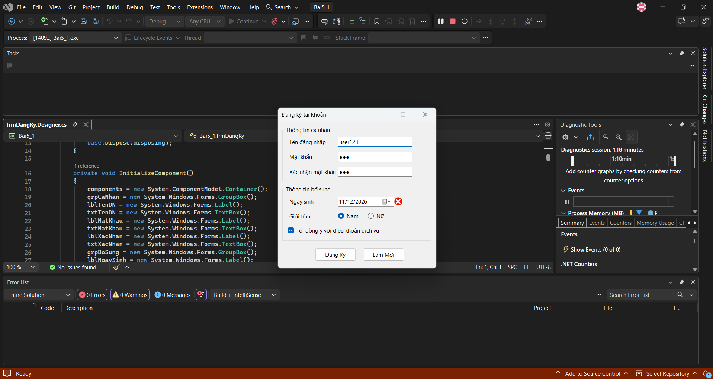
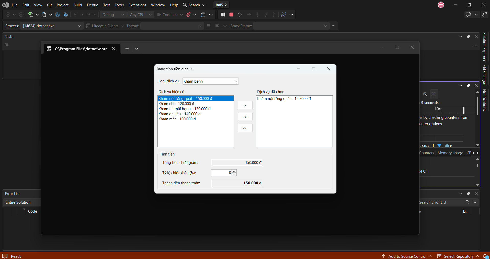
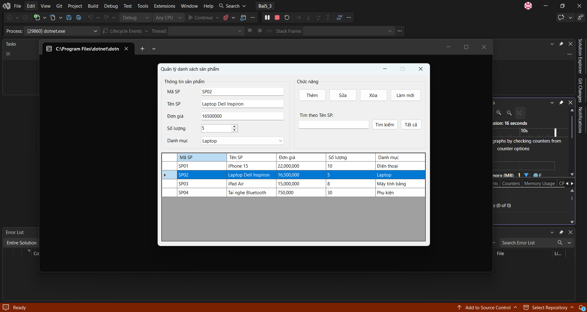
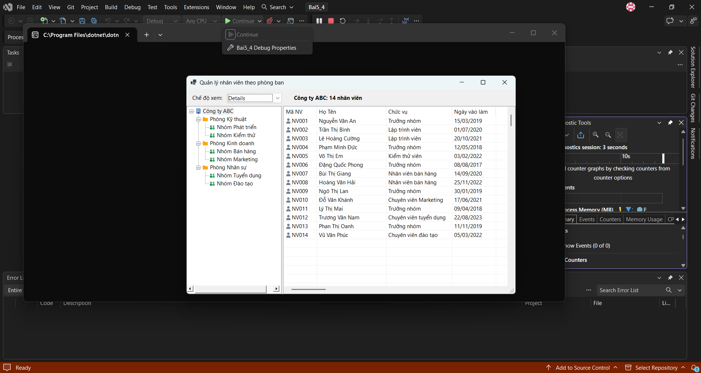

# BÁO CÁO BÀI TẬP / ĐỒ ÁN

## THÔNG TIN SINH VIÊN

- **Họ và tên:** Nguyễn Trung Hiếu
- **Mã số sinh viên:** 24810310212
- **Lớp:** D19CNPM3
- **Tên môn học:** Lập trình C# / Windows Forms
- **Tên bài tập:** bai5_1 ---> bai 5_4 ngày 12/11

---

## KẾT QUẢ THỰC HÀNH

### 1. Ảnh màn hình Giao dien bài 5_1

### 2. Ảnh màn hình Giao dien bài 5_2

### 3.  Ảnh màn hình Giao dien bài 5_3

### 4. Ảnh màn hình Giao dien bài 5_4
