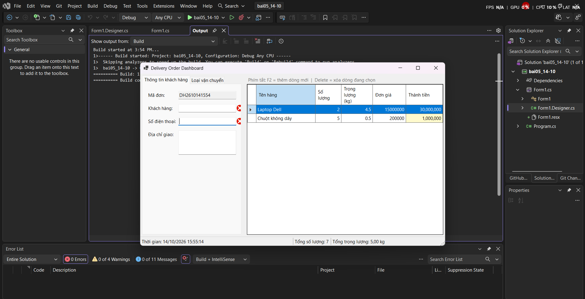
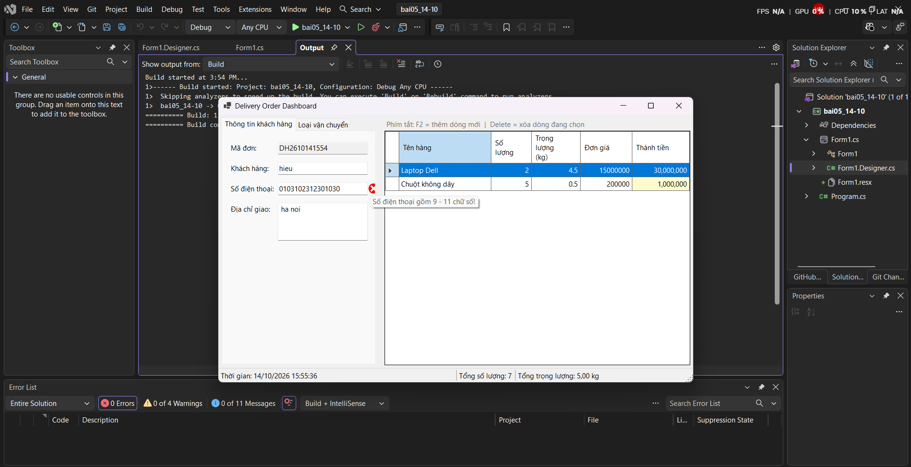
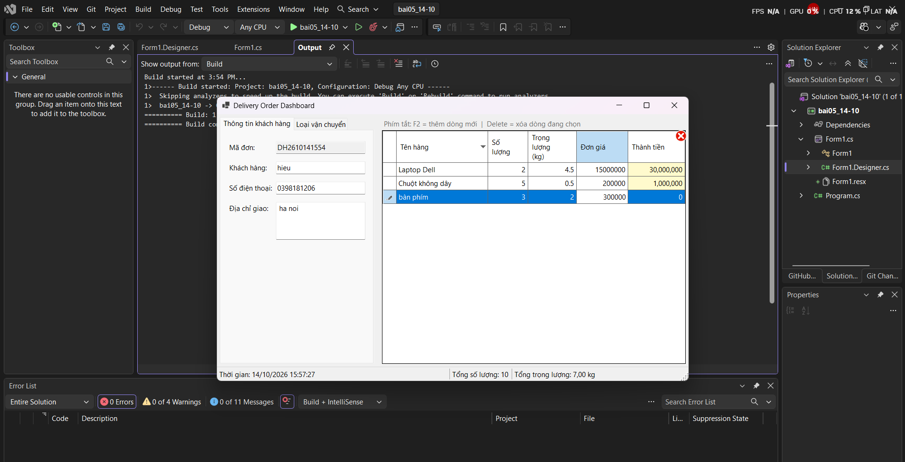
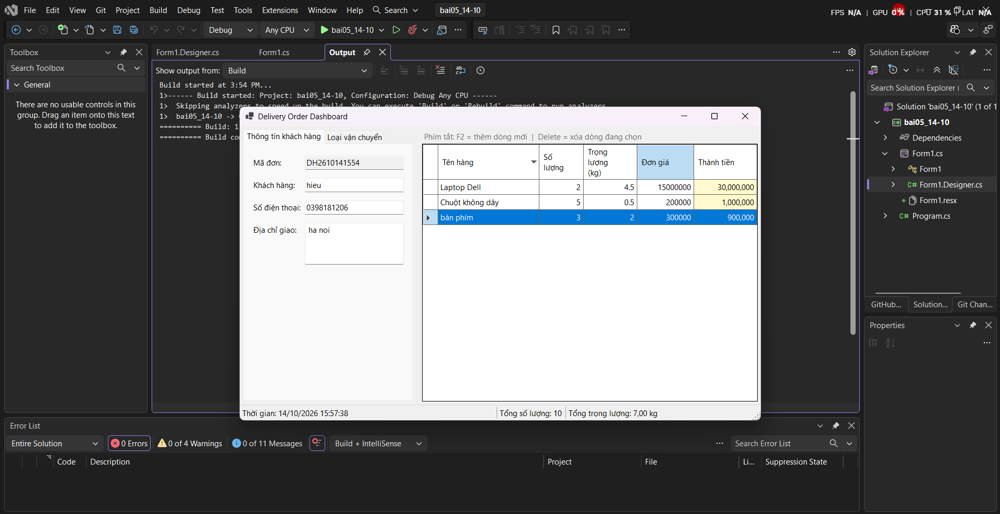
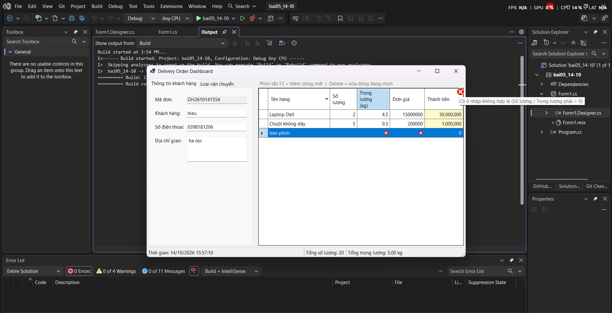

# BÁO CÁO BÀI TẬP / ĐỒ ÁN

## THÔNG TIN SINH VIÊN

- **Họ và tên:** Nguyễn Trung Hiếu
- **Mã số sinh viên:** 24810310212
- **Lớp:** D19CNPM3
- **Tên môn học:** Lập trình C# / Windows Forms
- **Tên bài tập:** bai05 ngày 14/10

---

## KẾT QUẢ THỰC HÀNH

### 1. Ảnh màn hình Giao dien khi không nhập
    

### 2. Ảnh màn hình lỗi nhập quá nhiều số

### 4.  Ảnh màn hình trước khi thành tiền

### 5.  Ảnh màn hình sau khi thành tiền

### 6.  Ảnh màn hình không nhập số trên vật liệu

### 7.  Ảnh màn hình sau khi nhấn F2
