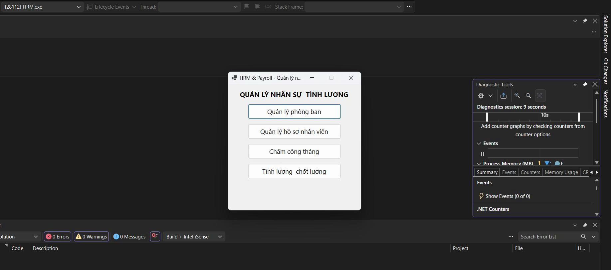

# BÁO CÁO BÀI TẬP / ĐỒ ÁN

## THÔNG TIN SINH VIÊN

- **Họ và tên:** Nguyễn Trung Hiếu
- **Mã số sinh viên:** 24810310212
- **Lớp:** D19CNPM3
- **Tên môn học:** Lập trình C# / Windows Forms
- **Tên bài tập:** bai6.2 ngày 17/11

---

## KẾT QUẢ THỰC HÀNH

### 1. Ảnh màn hình Giao dien truoc khi dang nhap

