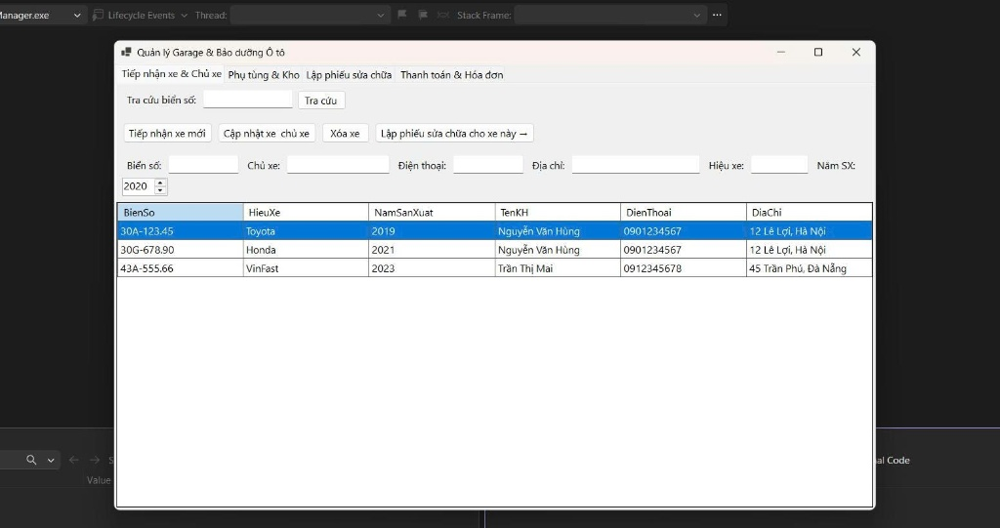
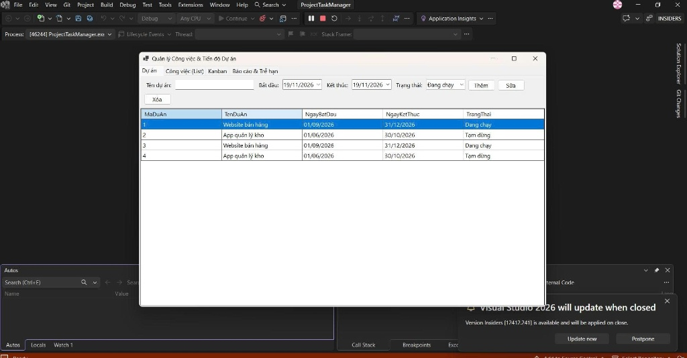
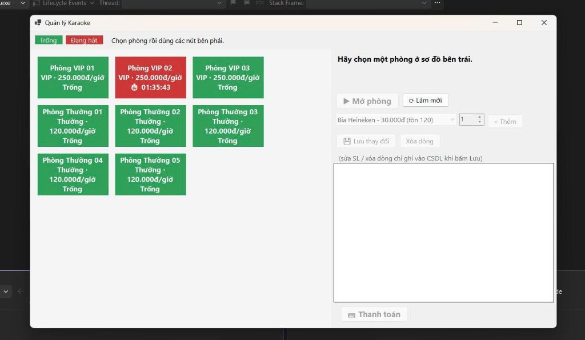

# BÁO CÁO BÀI TẬP / ĐỒ ÁN

## THÔNG TIN SINH VIÊN

- **Họ và tên:** Nguyễn Trung Hiếu
- **Mã số sinh viên:** 24810310212
- **Lớp:** D19CNPM3
- **Tên môn học:** Lập trình C# / Windows Forms
- **Tên bài tập:** bai6.3 6.4 6.5 ngày 19/11

---

## KẾT QUẢ THỰC HÀNH

### 1. Ảnh màn hình Giao dien bài 1

### 2. Ảnh màn hình Giao dien bài 2

### 1. Ảnh màn hình Giao dien bài 3

