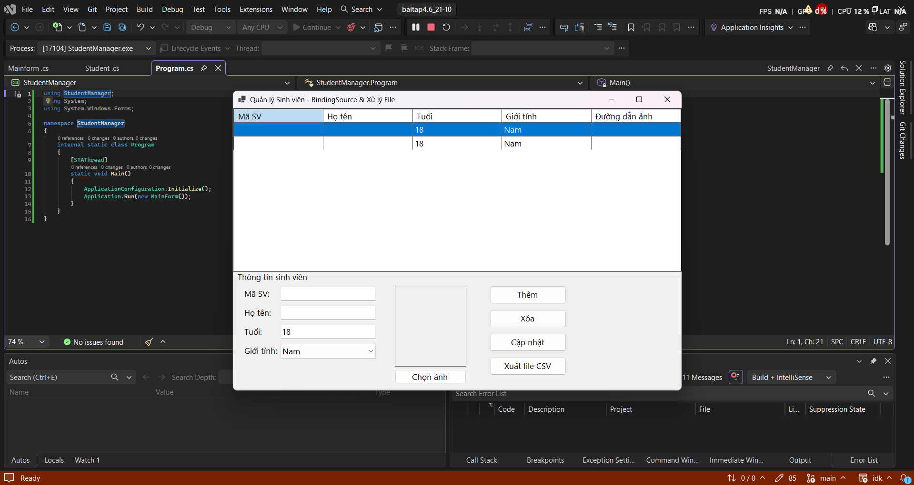
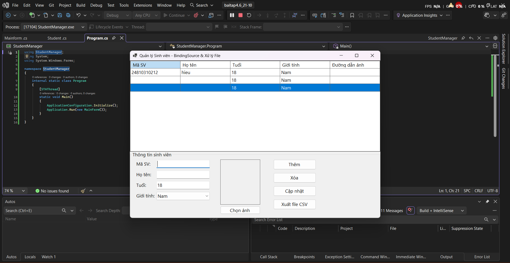
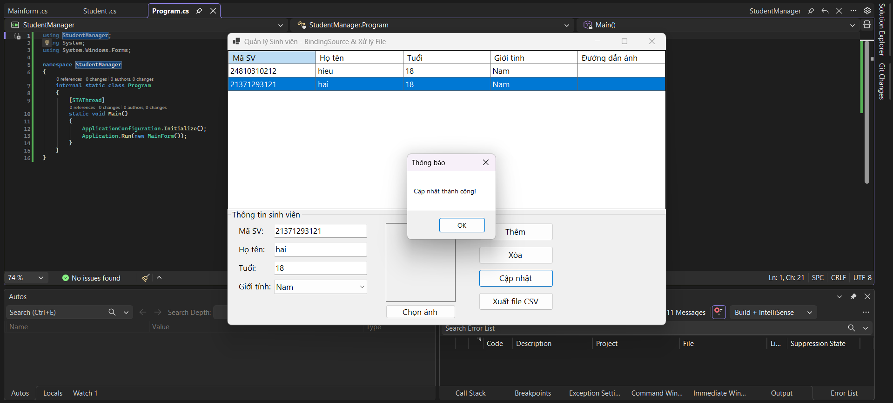
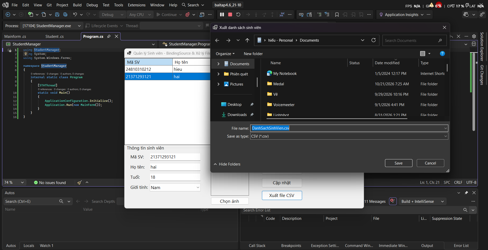
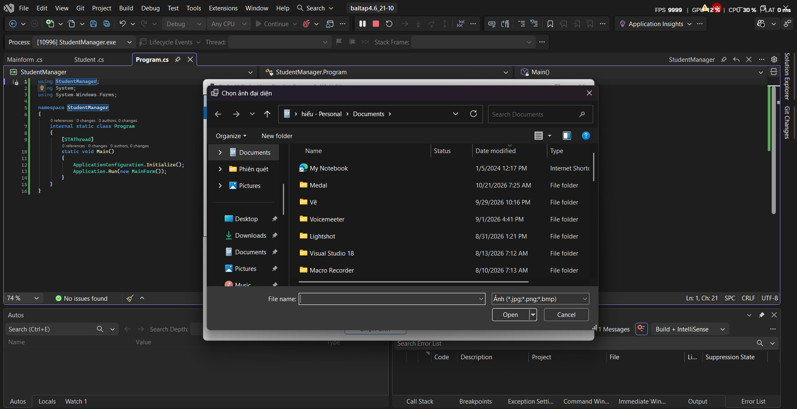

# BÁO CÁO BÀI TẬP / ĐỒ ÁN

## THÔNG TIN SINH VIÊN

- **Họ và tên:** Nguyễn Trung Hiếu
- **Mã số sinh viên:** 24810310212
- **Lớp:** D19CNPM3
- **Tên môn học:** Lập trình C# / Windows Forms
- **Tên bài tập:** bai4.6 ngày 21/10

---

## KẾT QUẢ THỰC HÀNH

### 1. Ảnh màn hình Giao dien quản lí sinh viên

### 2. Ảnh màn hình Chức năng thêm mới

### 3. Ảnh màn hình Chức năng xóa
.png)

### 4. Ảnh màn hình Chức năng cập nhật
 

### 5. Ảnh màn hình Chức năng xuất file

### 6. Ảnh màn hình Chức năng chọn ảnh

