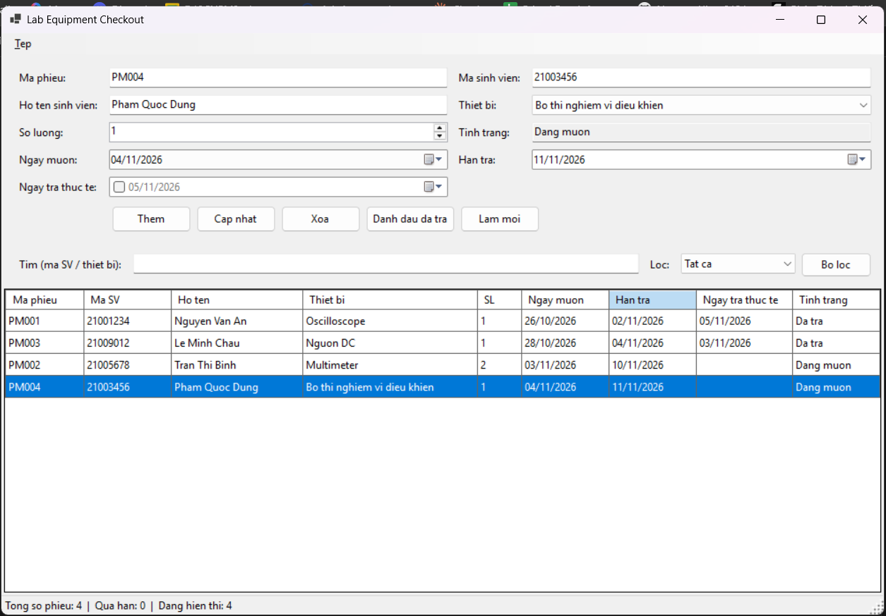
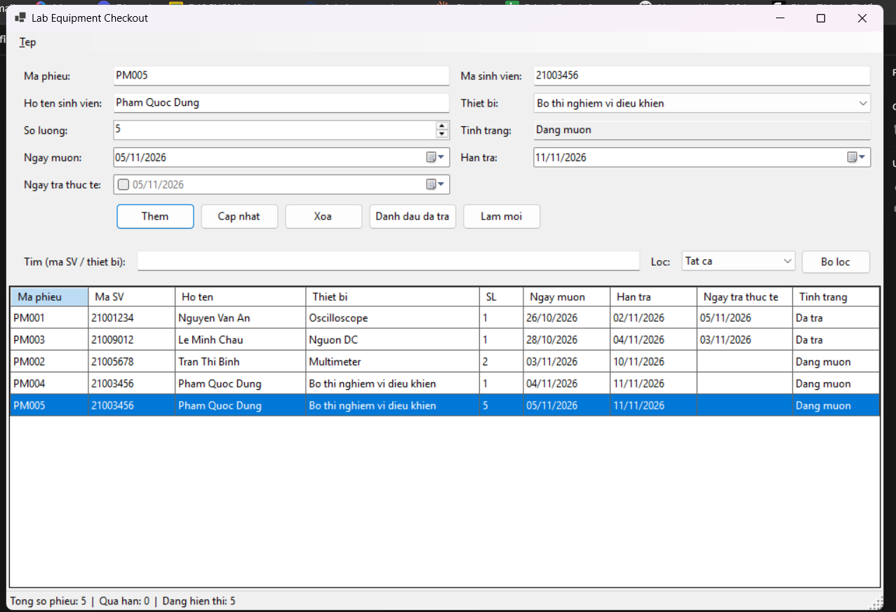
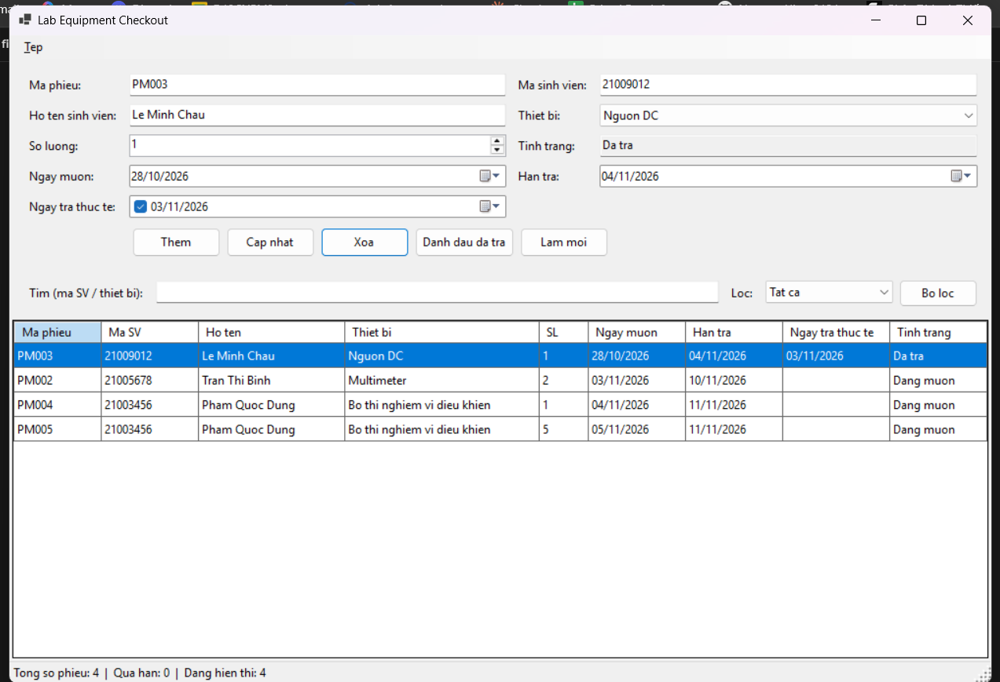
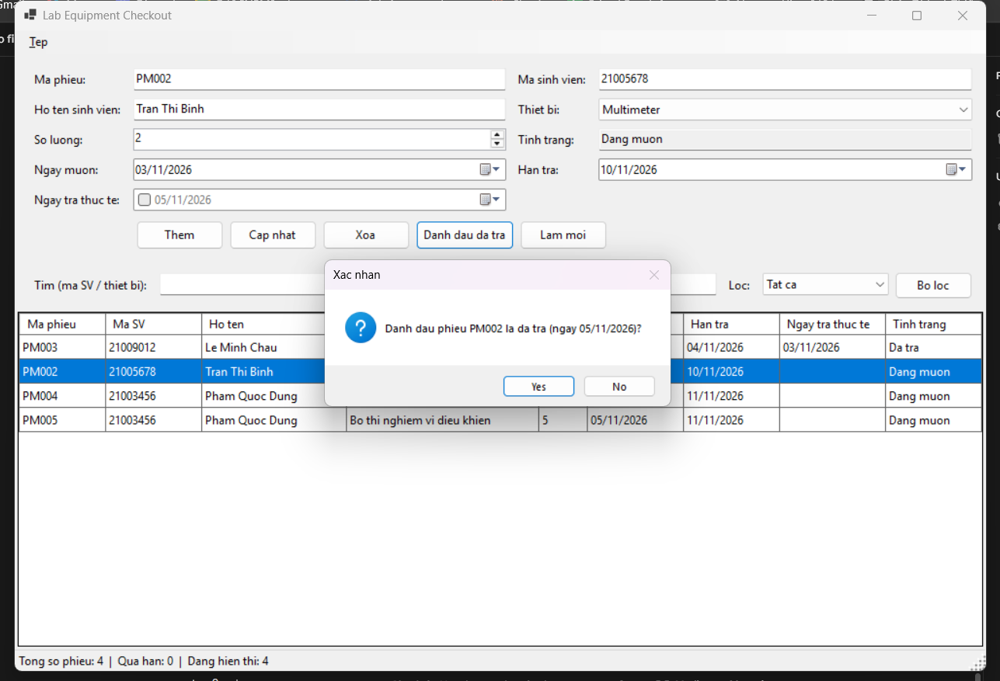
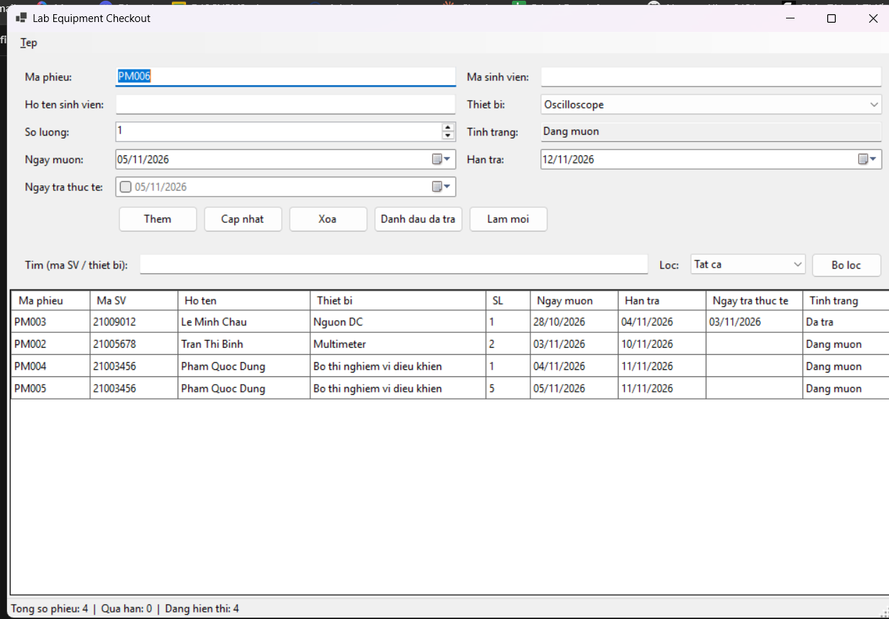

# BÁO CÁO BÀI TẬP / ĐỒ ÁN

## THÔNG TIN SINH VIÊN

- **Họ và tên:** Nguyễn Trung Hiếu
- **Mã số sinh viên:** 24810310212
- **Lớp:** D19CNPM3
- **Tên môn học:** Lập trình C# / Windows Forms
- **Tên bài tập:** bai4.9 ngày 5/11

---

## KẾT QUẢ THỰC HÀNH

### 1. Ảnh màn hình Giao dien 

### 2. Ảnh màn hình sau khi them moi

### 3.  Ảnh màn hình sau khi xoa

### 4.  Ảnh màn hình sau khi đánh dấu

### 3.  Ảnh màn hình làm mới

